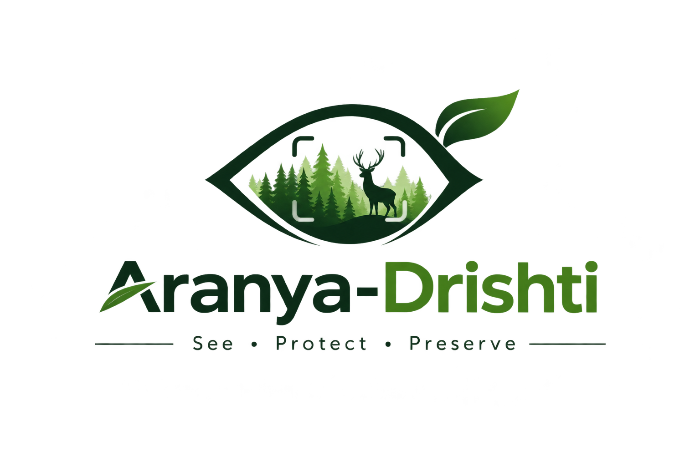

<p align="center">
  <picture>
    
  </picture>
</p>

<h1 align="center">🌲 Aranya-Drishti (ಅರಣ್ಯ ದೃಷ್ಟಿ)</h1>
<h3 align="center">Autonomous Acoustic Surveillance Command Center & Wildlife Biosphere Portal</h3>
<p align="center"><em>Western Ghats Biosphere Reserve · Kudremukh Wildlife Division · Karnataka Forest Department</em></p>

<p align="center">
  <a href="https://www.typescriptlang.org/"></a>
  <a href="https://react.dev/"></a>
  <a href="https://vitejs.dev/"></a>
  <a href="https://tailwindcss.com/"></a>
  <a href="https://leafletjs.com/"></a>
  <a href="https://developer.mozilla.org/en-US/docs/Web/API/Web_Audio_API"></a>
  <a href="LICENSE"></a>
</p>

> **Aranya-Drishti** (*Sanskrit / Kannada: "The Vision of the Forest" — See · Protect · Preserve*) is an enterprise-grade autonomous acoustic intelligence platform and conservation command center engineered for the Karnataka Forest Department (Kudremukh Wildlife Division). It combines an editorial wildlife sanctuary experience portal with real-time tactical surveillance, edge bioacoustic AI inference, and automated bilingual alert dispatch.

---

## 📑 Table of Contents

- [Executive Overview](#-executive-overview)
- [Enterprise Multi-View Architecture](#-enterprise-multi-view-architecture)
- [System Architecture](#-system-architecture)
- [Core Features & Engineering Highlights](#-core-features--engineering-highlights)
- [Acoustic Sentinel Tower Grid (Kudremukh Perimeter)](#-acoustic-sentinel-tower-grid-kudremukh-perimeter)
- [Bioacoustic Machine Learning & Classification Pipeline](#-bioacoustic-machine-learning--classification-pipeline)
- [Client-Side Audio Synthesis Engine](#-client-side-audio-synthesis-engine)
- [Getting Started / Local Development](#-getting-started--local-development)
  - [Prerequisites](#prerequisites)
  - [Installation & Startup](#installation--startup)
  - [Available Scripts](#available-scripts)
  - [Environment Variables](#environment-variables)
- [Directory & Component Layout](#-directory--component-layout)
- [Bilingual Alerting & Telegram Gateway](#-bilingual-alerting--telegram-gateway)
- [Standard Operating Procedure (SOP) & Legal Protocol](#-standard-operating-procedure-sop--legal-protocol)
- [Company Software Development Standards](#-company-software-development-standards)
- [License & Acknowledgments](#-license--acknowledgments)
- [Project Team & Submission Details](#-project-team--submission-details)

---

## 🎯 Executive Overview

The Western Ghats of Karnataka (UNESCO World Heritage Site) house vulnerable tropical rainforest corridors subject to critical pressures:
1. **Illegal Timber Felling**: Clandestine extraction of valuable indigenous timber (Rosewood, Teak, Sandalwood) utilizing high-RPM two-stroke motorized chainsaws.
2. **Human-Elephant Conflict (HEC)**: Herds crossing fragmented buffer zones into agricultural arecanut, rubber, and paddy plantations near Kadaba and Shiradi, leading to crop damage and endangered animal retaliation.

**Aranya-Drishti** delivers a unified company-grade platform:
- **Public & Conservation Experience Portal**: An editorial wildlife sanctuary landing page inspired by world-class park platforms (Bearizona style), featuring high-impact visual design, an editorial white/light section, an interactive threat audio soundboard, and a protected fauna gallery.
- **Real-Time Tactical Command Deck**: Embedded directly on the portal or accessible in full-screen console mode, rendering satellite GIS maps with pulsing radar beacons, live HTML5 Canvas oscilloscopes and FFT spectrums, incident triage drawers, and field strike unit rosters.
- **Edge Bioacoustic AI Inference**: Classifies frequency, zero-crossing rates, and infrasonic energy ratios (<80 Hz) with a strict >75% confidence threshold.
- **Bilingual Alert Dispatch**: Broadcasts synchronous warnings (**English & Kannada**) to beat guards and gram panchayats via instant notifications and optional Telegram Webhooks.

---

## 🏛️ Enterprise Multi-View Architecture

Aranya-Drishti provides six distinct, production-ready operational views accessible from the top navigation bar:

1. **`Overview` (Sanctuary & Conservation Portal - Bearizona Style)**:
   - Full-bleed hero with wild Asian elephant imagery and editorial typography: *"It's Time To Protect The Wild"*.
   - Floating white quick-cards strip: Perimeter Coverage, Sentinel Grid, AI Threat Engine, Ranger Strike Force.
   - Editorial white section with Bengal Tiger portrait, bioacoustic engineering overview, and real-world metrics.
   - 4-card interactive threat signature showcase with instant playback buttons.
   - Embedded real-time operations console (Leaflet map + live audio visualizer + grid health + incident table).
   - Nilgiri Biosphere conservation impact statistics.
   - "Explore Protected Wildlife" gallery with bioacoustic voice simulations for iconic Western Ghats species.
   - Emergency hotline & ranger strike fund banner.
   - Enterprise multi-column footer with illuminated white logo capsule and 24/7 hotline directory.

2. **`Operations Console` (Full-Screen Tactical Command Deck)**:
   - Fullscreen Leaflet satellite map with dark ops, satellite, and terrain layers.
   - 5 Sentinel towers with green calm radar vs red threat radar shockwave blips.
   - Live Audio Ingestion Module with real-time HTML5 Canvas oscilloscope & 48-band FFT spectrum.
   - 5-node telemetry cards with live voltage, solar wattage, signal, and quick drill triggers.
   - Incident register table with CSV export.

3. **`Audio Screening` (Bioacoustic Lab & Model Inspection)**:
   - 3-second live microphone capture with interactive recording countdown.
   - Drag-and-drop .WAV file decoder.
   - 3 synthesized test presets (Chainsaw, Elephant rumble/trumpet, Monsoon rain/cicadas).
   - Deep model parameter cards (ZCR filters, infrasound ratios, SNR targets).

4. **`Incidents` (Forensic Incident Register)**:
   - Searchable, filterable event log.
   - Admissible evidence records under Section 27, Karnataka Forest Act 1963.
   - Instant CSV dossier export for court filings.

5. **`Patrol Units` (Field Strike Camps & Deployments)**:
   - Anti-Poaching Camps (APC) and Elephant Task Force (ETF) roster.
   - Ranger counts, lead officers, 4x4 vehicle specs, and encrypted VHF frequencies (154.250 MHz).

6. **`Architecture` (Hardware & Engineering Specifications)**:
   - Solar mast hardware blueprint, DSP pipeline specs, bilingual Telegram gateway, and legal frameworks.

---

## 🏗️ System Architecture

```
                       +-------------------------------------------------------------+
                       |               Western Ghats Acoustic Perimeter              |
                       |       5x Solar-Powered Edge Sentinel Towers (A, B, C, D, E) |
                       +-------------------------------------------------------------+
                                       |                                    |
                    [Infrasound Sub-Sensors 14-35 Hz]        [MEMS Microphones 100Hz-8kHz]
                                       \                                    /
                                        +----------------------------------+
                                        |  VHF / LoRa / 4G Cellular Link   |
                                        +----------------------------------+
                                                         |
                                                         v
 +---------------------------------------------------------------------------------------------------------------+
 |                                          ARANYA-DRISHTI COMMAND ENGINE                                        |
 |                                                                                                               |
 |  +-------------------------------------+   +-------------------------------------+   +---------------------+  |
 |  |    Audio Ingestion & Screening      |   |   Bioacoustic Feature Extraction    |   |  Confidence Matrix  |  |
 |  |  - Live Workstation Mic Stream      |-->|  - Spectral Centroid & ZCR          |-->|  - Strict >75% Rule |  |
 |  |  - .WAV / .MP3 Drag & Drop Ingestion|   |  - Infrasonic Energy Ratio (<80Hz)  |   |  - Priority Alert   |  |
 |  |  - Synthesized Bioacoustic Presets  |   |  - Signal-to-Noise Ratio (dBFS)     |   |  - Review Required  |  |
 |  +-------------------------------------+   +-------------------------------------+   +---------------------+  |
 |                                                                                                 |             |
 |  +----------------------------------------------------------------------------------------------+             |
 |  |                                                                                                            |
 |  v                                              v                                               v             |
 | +-----------------------------+     +-----------------------------+               +-------------------------+ |
 | |   Leaflet Operations Map    |     |  Incident Operations Drawer |               |  Bilingual Alert Engine | |
 | | - Dark Ops / Satellite Tiles|     | - Audio Scrubber Replay     |               | - English & Kannada SMS | |
 | | - Green / Red Radar Beacons |     | - Strike Patrol Dispatch    |               | - Telegram Bot Webhook  | |
 | | - Forest Boundary Geometry  |     | - False Positive Resolution |               | - Gram Panchayat Audio  | |
 | +-----------------------------+     +-----------------------------+               +-------------------------+ |
 +---------------------------------------------------------------------------------------------------------------+
```

---

## 🚀 Core Features & Engineering Highlights

| Feature | Tech Implementation | Benefit |
| :--- | :--- | :--- |
| **Wildlife Sanctuary Portal** | Editorial React Layout + High-Impact Wildlife Photography | Combines public conservation engagement with company-grade operational utility (Bearizona style). |
| **Tactical Satellite GIS** | Leaflet.js + Custom SVG Markers + Dark Ops & Esri Tiles | Instant spatial awareness with concentric animated shockwave radar pings. |
| **Synthetic Audio Engine** | Pure Web Audio API (Multi-oscillator Formant Synthesis) | Runs **100% out-of-the-box** with zero external audio assets or audio file dependencies. |
| **Fauna Voice Simulators** | Elephant rumble, Bengal tiger roar, Macaque whoop | Authentic bioacoustic simulations for ranger training and public wildlife education. |
| **Real-Time Visualizer** | HTML5 Canvas + `AnalyserNode` (Dual View) | Live oscilloscope waveform and 48-band FFT spectrum visualizer with dBFS meters. |
| **Bilingual Dispatch** | UTF-8 Kannada + English Notification Module | Delivers immediate, accessible warnings to both senior officials and local villagers. |
| **High-Visibility Logo** | Elevated pure white enclosure with shadow | 100% legibility of the official Aranya-Drishti forest & deer emblem on dark or light backgrounds. |
| **Patrol Strike Roster** | Tactical deployment modal with ETA calculations | Coordinates rapid anti-poaching squads and Elephant Task Force (ETF) vehicles. |
| **Evidence Dossier** | Filterable register with CSV report generation | Formats admissible records for documentation under the **Karnataka Forest Act 1963**. |

---

## 🗺️ Acoustic Sentinel Tower Grid (Kudremukh Perimeter)

| Tower ID | Sector Name | Kannada Sector Name | Coordinates (Lat, Lng) | Elevation | Range | Primary Eco-Zone |
| :--- | :--- | :--- | :--- | :--- | :--- | :--- |
| **TOWER-A** | Sector 1 - Kudremukh North | ವಲಯ 1 - ಕುದುರೆಮುಖ ಉತ್ತರ | `13.234° N, 75.252° E` | 1,894 m | 2.8 km | Shola Grasslands / Wet Evergreen |
| **TOWER-B** | Sector 2 - Netravati River Buffer | ವಲಯ 2 - ನೇತ್ರಾವತಿ ನದಿ ಬಫರ್ | `13.082° N, 75.318° E` | 820 m | 2.4 km | Riparian Dense River Valley |
| **TOWER-C** | Sector 3 - Kadaba Fringe | ವಲಯ 3 - ಕಡಬ ಗಡಿಭಾಗ | `12.784° N, 75.395° E` | 240 m | 3.2 km | Forest-Agriculture Elephant Corridor |
| **TOWER-D** | Sector 4 - Shiradi Foothills | ವಲಯ 4 - ಶಿರಾಡಿ ತಪ್ಪಲು | `12.928° N, 75.602° E` | 640 m | 2.6 km | Semi-Evergreen High-Felling Area |
| **TOWER-E** | Sector 5 - Nagarhole Border | ವಲಯ 5 - ನಾಗರಹೊಳೆ ಗಡಿಭಾಗ | `12.583° N, 75.681° E` | 910 m | 3.0 km | Moist Deciduous Wildlife Corridor |

---

## 🧠 Bioacoustic Machine Learning & Classification Pipeline

The client-side intelligence layer processes 48 kHz / 16-bit PCM audio through a multi-stage acoustic classifier:

### 1. Feature Extraction Parameters
- **Zero-Crossing Rate (ZCR)**: Quantifies the sign-change rate of the audio waveform. High ZCR ($\ge 0.55$) strongly correlates with mechanical friction, sawteeth biting timber, and combustion exhaust rasp.
- **Spectral Centroid**: The "center of mass" of the frequency spectrum. Mechanical chainsaws cluster between $1,800\text{ Hz} - 2,800\text{ Hz}$, whereas ambient rainfall sits above $3,500\text{ Hz}$.
- **Infrasonic Energy Ratio ($<80\text{ Hz}$)**: Measures subterranean acoustic energy. Elephant rumbles yield visceral energy in the $18\text{ Hz} - 35\text{ Hz}$ window.
- **Signal-to-Noise Ratio (SNR dB)**: Eliminates false triggers from wind gust turbulence.

### 2. Decision Logic
```typescript
if (infrasonicEnergy > 0.65 || (peakFrequencyHz < 350 && zeroCrossingRate < 0.25)) {
  // Classification: Elephant Vocalization Signature
  // Threat Severity: Warning / Conflict Mitigation
} else if (zeroCrossingRate > 0.50 && spectralCentroidHz > 1600 && snrDb > 14) {
  // Classification: Chainsaw Motor Signature
  // Threat Severity: CRITICAL (Illegal Timber Felling)
} else {
  // Classification: Normal Canopy Ambiance / Rain
  // Threat Severity: Nominal Baseline
}
```

- **Confidence Threshold Rule**:
  - $\text{Confidence} > 75\%$: Triggers instant **Priority Red Alert** with flashing radar blips and siren broadcast.
  - $\text{Confidence} \le 75\%$: Flags event for ranger review.

---

## 🔊 Client-Side Audio Synthesis Engine (`audioEngine.ts`)

Aranya-Drishti operates **100% offline** in browser sandboxes using Web Audio API synthesis without requiring external audio downloads:

1. **Two-Stroke Chainsaw Motor (`createChainsawBuffer`)**:
   - Fundamental combustion rate swept between $75\text{ Hz}$ and $265\text{ Hz}$ with throttle modulation.
   - Sawtooth oscillator with sub-harmonic engine cylinder rattles ($40 - 60\text{ Hz}$) and high-frequency tooth chatter ($5.2\times f_0$).
2. **Asian Elephant Infrasound & Trumpet (`createElephantBuffer`)**:
   - Subterranean chest rumbles ($18 - 32\text{ Hz}$) with visceral amplitude tremolo.
   - Resonant trumpet formant glide ($220\text{ Hz} \to 480\text{ Hz} \to 310\text{ Hz}$) with brass-like harmonics and breath rasp.
3. **Bengal Tiger Roar (`createTigerBuffer`)**:
   - Deep guttural resonance ($60 - 120\text{ Hz}$) with throat rasp modulation and acoustic territorial projection.
4. **Lion-Tailed Macaque Call (`createMacaqueBuffer`)**:
   - Endemic arboreal canopy contact whoop frequency-swept between $650\text{ Hz}$ and $1,350\text{ Hz}$.
5. **Monsoon Rain Canopy Baseline (`createAmbientBuffer`)**:
   - Pinkish/brownian noise simulating steady rainfall and canopy wind, with high-frequency cicada bursts ($5,400\text{ Hz}$).

---

## 💻 Getting Started / Local Development

### Prerequisites
- **Node.js**: `v20.x` or higher (tested on Node `22.x`)
- **Package Manager**: `npm` `10.x` or higher
- **Modern Browser**: Chrome, Edge, Safari, or Firefox with Web Audio API support.

### Installation & Startup

```bash
# 1. Clone the repository
git clone https://github.com/your-org/aranya-drishti.git
cd aranya-drishti

# 2. Install dependencies cleanly
npm install

# 3. Setup environment variables (optional for local mock testing)
cp .env.example .env

# 4. Launch development server on port 3000
npm run dev
```

Visit **`http://localhost:3000`** in your browser. The application initializes immediately with fully functional mock generators and pre-configured telemetry.

---

### Available Scripts

| Command | Action |
| :--- | :--- |
| `npm run dev` | Runs the local Vite dev server with hot reload at `localhost:3000` |
| `npm run build` | Compiles and packages production assets into `/dist` via `tsc -b && vite build` |
| `npm run lint` | Executes TypeScript compiler verification (`tsc --noEmit`) to catch type faults |
| `npm run preview` | Starts a local server to preview the production build artifacts |

---

### Environment Variables

Configure these in `.env` (or via the AI Studio Secrets panel in production):

```env
# GEMINI_API_KEY: Optional - enables server-side generative analysis reports
GEMINI_API_KEY="AIzaSy..."

# APP_URL: Production or preview host URL
APP_URL="https://your-domain.run.app"
```

*(Note: Live Telegram integration can also be configured dynamically in the UI modal via Bot Token and Chat ID).*

---

## 📂 Directory & Component Layout

```
.
├── .env.example                     # Environment template (no secrets committed)
├── index.html                       # HTML5 entry point (Fraunces, Manrope & JetBrains Mono fonts)
├── metadata.json                    # AI Studio manifest & microphone permissions
├── package.json                     # Project manifest and scripts
├── tsconfig.json                    # Strict TypeScript configuration
├── vite.config.ts                   # Vite bundler configuration with Tailwind v4 plugin
├── public/
│   └── assets/aistudio/
│       └── image_033d2753.png       # Official Aranya-Drishti logo (See · Protect · Preserve)
└── src/
    ├── main.tsx                     # React 19 root bootstrap
    ├── index.css                    # Tailwind CSS v4 directives & Leaflet dark ops styling
    ├── App.tsx                      # Primary Command Center & Bearizona-style Sanctuary Portal
    ├── assets/images/
    │   ├── hero_western_ghats_elephant_*.jpg  # High-impact elephant photography
    │   ├── wildlife_bengal_tiger_*.jpg        # Bengal tiger sanctuary portrait
    │   ├── forest_chainsaw_timber_*.jpg       # Chainsaw timber felling threat visual
    │   └── canopy_monsoon_rainforest_*.jpg    # Monsoon canopy ambient rainforest
    ├── data/
    │   └── towers.ts                # 5 Sentinel towers, GPS coordinates, initial incidents
    ├── utils/
    │   ├── audioEngine.ts           # Web Audio API engine (synthesizers, mic recorder, WAV encoder)
    │   └── inferenceEngine.ts       # Acoustic feature extraction, classification & Telegram dispatcher
    └── components/
        ├── OperationsMap.tsx        # Leaflet tactical satellite map with pulsing radar beacons
        ├── AudioIngestionModule.tsx # 3-mode audio intake (Mic, File Upload, 3 Quick-Demo presets)
        ├── AudioVisualizer.tsx      # Dual-mode HTML5 Canvas oscilloscope & 48-band FFT spectrum
        ├── IncidentDrawer.tsx       # Slide-over incident dossier with audio scrubber & team dispatch
        ├── IncidentLogTable.tsx     # Searchable/filterable incident table with CSV export
        ├── SentinelGridHealth.tsx   # 5-node hardware telemetry strip with quick-trigger drills
        ├── TelegramAlertModal.tsx   # Bilingual SMS/Telegram alert pop-up with Webhook gateway
        └── PatrolUnitsModal.tsx     # Tactical Anti-Poaching Camp (APC) and ETF vehicle roster
```

---

## 📱 Bilingual Alerting & Telegram Gateway

Every threat event generates synchronized bilingual communications:

### 1. Elephant Movement (ಕಡಬ ಗಡಿಭಾಗ / Kadaba Fringe)
- **English**:
  > `⚠️ ALERT: Elephant movement detected at Tower C (Kadaba Fringe). Avoid agricultural perimeters and fringe trails.`
- **Kannada**:
  > `⚠️ ಎಚ್ಚರಿಕೆ: ಗೋಪುರ C (ಕಡಬ ಗಡಿಭಾಗ) ಬಳಿ ಆನೆಗಳ ಚಲನವಲನ ಕಂಡುಬಂದಿದೆ. ರೈತರು ತೋಟಗಳ ಬಳಿ ಹೋಗದೆ ಸುರಕ್ಷಿತ ಸ್ಥಳದಲ್ಲಿರಿ.`

### 2. Illegal Chainsaw Logging (ಕುದುರೆಮುಖ ಉತ್ತರ / Kudremukh North)
- **English**:
  > `🚨 CRITICAL ALERT: Chainsaw motor acoustic signature detected at Tower A (Kudremukh North). Illegal timber felling in progress. Lat: 13.234, Lng: 75.252. Dispatch anti-poaching camp immediately.`
- **Kannada**:
  > `🚨 ಗಂಭೀರ ಎಚ್ಚರಿಕೆ: ಗೋಪುರ A (ಕುದುರೆಮುಖ ಉತ್ತರ) ಬಳಿ ಮರ ಕಡಿಯುವ ಯಂತ್ರದ (ಚೈನ್ಸಾ) ಶಬ್ದ ಪತ್ತೆಯಾಗಿದೆ. ಅಕ್ರಮ ಮರ ಕಡಿತ ನಡೆಯುತ್ತಿದೆ. ಅರಣ್ಯ ಸಂರಕ್ಷಣಾ ತಂಡವನ್ನು ಕೂಡಲೇ ರವಾನಿಸಿ.`

---

## 📋 Standard Operating Procedure (SOP) & Legal Protocol

When an alert triggers in the field, rangers follow a 4-step workflow compliant with the **Karnataka Forest Act 1963** & **Wildlife Protection Act 1972**:

```
[1. ACOUSTIC TRIGGER] ──> [2. CONFIRM & ACK] ──> [3. PATROL DISPATCH] ──> [4. RECORD & EXPORT]
- Infrasound / motor      - Review confidence %   - Select nearest APC    - Export time-stamped
  vibration detected       and replay snippet      unit (ETA 5-15 min)     CSV dossier for court
  at boundary tower.       in incident drawer.     via encrypted VHF.      evidence and FIR.
```

---

## 🏢 Company Software Development Standards

To maintain professional engineering hygiene, contributions must adhere to the following standards:

1. **Zero-Pill Typography Discipline**:
   - Avoid static decorative pill containers for metadata. Use clean unboxed text separated by typographic markers (`·`, `/`).
2. **Strict Top Bar Contract**:
   - The top navigation bar contains exactly three zones: `[Brand Wordmark]` — `[4-5 Single-line Links]` — `[1 Primary Action Button]`.
3. **Compositor-Only Animations**:
   - Animate only `transform`, `opacity`, and `filter`. Avoid layout thrashing on high-frequency audio visualizers.
4. **Hermetic Out-of-the-Box Operation**:
   - The project must build and run on any developer machine without external media hosts or proprietary local files.
5. **Git Commit Format**:
   - Follow [Conventional Commits](https://www.conventionalcommits.org/):
     - `feat(audio): add Mel-frequency band classifier`
     - `fix(map): correct marker pulse anchor position`
     - `docs(readme): add enterprise deployment guidelines`

---

## 📜 License & Acknowledgments

- **License**: Distributed under the **Apache 2.0 License**. See [LICENSE](LICENSE) for details.
- **Field Data Grounding**: Western Ghats Forest Division & Kudremukh Wildlife Division GIS coordinates.
- **Acoustic Standards**: Formulated in accordance with bioacoustic monitoring standards for the Asian Elephant (*Elephas maximus*) and motorized two-stroke forestry equipment.

---

## 👥 Project Team & Submission Details

| Parameter | Details |
| :--- | :--- |
| **Track Name** | **TPS3 — VASUNDHARA \| PROTECTING INDIA'S NATURAL WEALTH** |
| **Team Name** | **PHONEIX** |
| **Team Members** | **ASHITH.C** · **ANOOP - A** · **SHRIRAKSHA S H** |

---

*Dedicated to the forest guards and wildlife rangers defending the biodiversity of the Western Ghats.* 🌲🐅🐘
